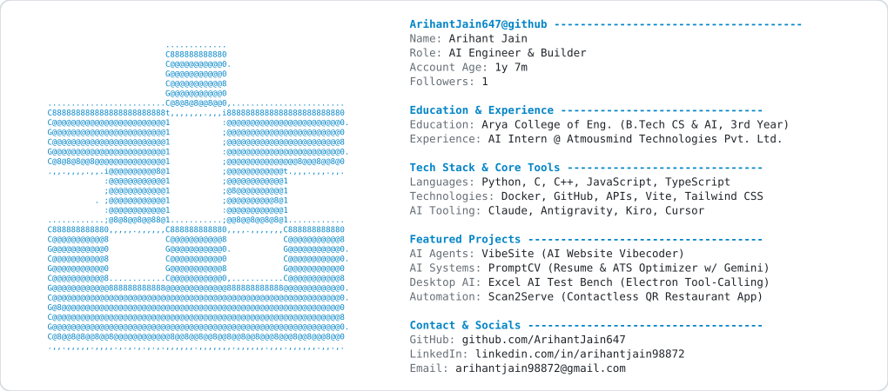
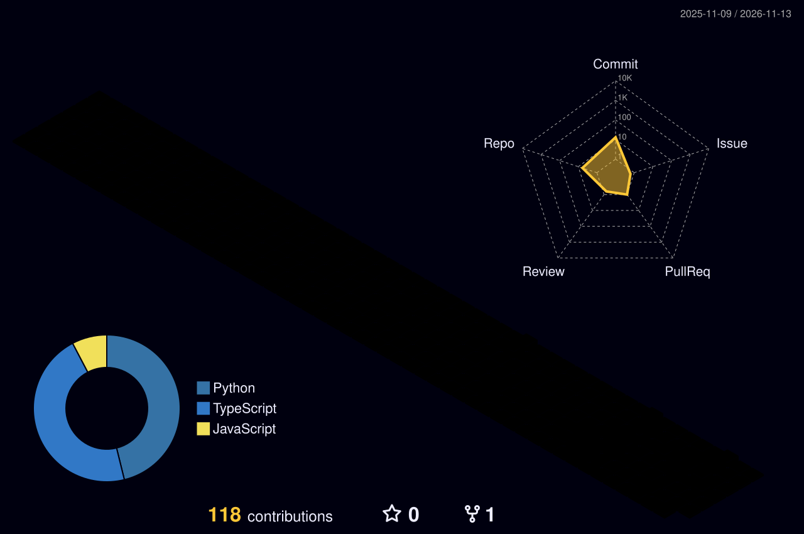

  <picture>
    <source media="(prefers-color-scheme: dark)" srcset="https://raw.githubusercontent.com/ArihantJain647/ArihantJain647/main/profile_card_dark.svg">
    
  </picture>

## 
<h4 align="center"><samp> AI Engineer & Builder | Turning ideas into intelligent products, automations, and real-world solutions ⚡ </samp></h4>

   

<ul>
<li>👨‍💻 <samp><b>AI Engineer & Builder</b> specializing in autonomous systems, intelligent agents, and full-stack AI applications.</samp></li>
<li>💼 <samp><b>AI Intern @ Atmousmind Technologies Pvt. Ltd.</b> — engineering applied AI solutions and proof-of-concept architectures.</samp></li>
<li>🎓 <samp><b>B.Tech in Computer Science & Artificial Intelligence (3rd Year)</b> @ Arya College of Engineering, Jaipur.</samp></li>
<li>🚀 <samp>Passionate about taking ideas from concept to functional, production-ready software.</samp></li>
<li>💬 <samp>Ask me about <b>LLM Tool-Calling, AI Agents, Python Engineering, Full Stack Web & Automation</b>.</samp></li>
<li>⚡ <samp>Philosophy: <b>"The fastest way to master AI is to build real products with it."</b></samp></li>
</ul>

---

<h3><b><samp>Connect & Socials:</samp></b></h3>

  
  &nbsp;&nbsp;
  
  &nbsp;&nbsp;
  
  &nbsp;&nbsp;
  

---

<h3><b><samp>Experience & Education:</samp></b></h3>

<table>
  <tr>
    <td width="50%" valign="top">
      <h4>💼 <b>Experience</b></h4>
      <ul>
        <li><b>AI Intern</b> @ <b>Atmousmind Technologies Pvt. Ltd.</b> 
        <i>Building applied AI pipelines, automated workflows, and production-grade prototypes.</i></li>
      </ul>
    </td>
    <td width="50%" valign="top">
      <h4>🎓 <b>Education</b></h4>
      <ul>
        <li><b>B.Tech – Computer Science & Artificial Intelligence</b> 
        <b>Arya College of Engineering, Jaipur</b> 
        <i>Currently in 3rd Year</i></li>
      </ul>
    </td>
  </tr>
</table>

---

<h3><b><samp>Skills & Tech Stack</samp></b></h3>

<h4><b><samp>Programming Languages</samp></b></h4>

  

<h4><b><samp>Tools, DevOps & Technologies</samp></b></h4>

  

<h4><b><samp>Frontend & Web Development</samp></b></h4>

  

<h4><b><samp>AI Engineering & Development Ecosystem</samp></b></h4>

  
  &nbsp;
  
  &nbsp;
  
  &nbsp;
  
  &nbsp;
  

 

---

<h3><b><samp>Featured Projects</samp></b></h3>

A curated selection of real-world AI applications, intelligent tools, and software solutions built by Arihant:

<table>
  <tr>
    <td width="50%" valign="top">
      <h3>🚀 <a href="https://github.com/ArihantJain647/PromptCV"><b>PromptCV</b></a></h3>
      
<b>AI-Powered Resume Analysis & ATS Optimization Platform</b>

      
Engineered an intelligent career platform powered by the <b>Gemini API</b> that evaluates candidate resumes against automated applicant tracking systems (ATS), providing scoring, keyword gap diagnostics, and actionable enhancements.

      

        
        
        
        
      

      

        🔗 <a href="https://github.com/ArihantJain647/PromptCV"><b>Repository</b></a> | 
        🌐 <a href="https://prompt-cv-six.vercel.app"><b>Live Demo</b></a>
      

    </td>
    <td width="50%" valign="top">
      <h3>🤖 <a href="https://github.com/ArihantJain647/VibeSite"><b>VibeSite</b></a></h3>
      
<b>Autonomous AI Website Vibecoder & Page Builder Agent</b>

      
An intelligent agentic system that transforms conversational prompts into production-ready web interfaces. Orchestrates LLM prompt pipelines, automated component structuring, and deployment workflows.

      

        
        
        
        
      

      

        🔗 <a href="https://github.com/ArihantJain647/VibeSite"><b>Repository</b></a> | 
        🌐 <a href="https://vibe-site-lime-nu.vercel.app"><b>Live Demo</b></a>
      

    </td>
  </tr>
  <tr>
    <td width="50%" valign="top">
      <h3>📊 <a href="https://github.com/ArihantJain647/excel-ai-electron-test"><b>Excel AI Test Bench</b></a></h3>
      
<b>Tool-Calling Desktop Agent for Real Spreadsheet Manipulation</b>

      
An Electron desktop application testing how an external AI reads and deterministically modifies real <code>.xlsx</code> spreadsheets. Features strict tool calling (<code>read_range</code>, <code>find_cells</code>, <code>set_cells</code>, <code>insert_rows</code>) with live audit and verification panels.

      

        
        
        
        
      

      

        🔗 <a href="https://github.com/ArihantJain647/excel-ai-electron-test"><b>Repository</b></a>
      

    </td>
    <td width="50%" valign="top">
      <h3>📱 <a href="https://github.com/ArihantJain647/scan2serve"><b>Scan2Serve</b></a></h3>
      
<b>Contactless Digital QR Dining & Restaurant Platform</b>

      
Responsive web platform revolutionizing dining operations. Allows patrons to scan table QR codes, browse live categorized menus, configure orders, and check out without waiter bottlenecks.

      

        
        
        
        
      

      

        🔗 <a href="https://github.com/ArihantJain647/scan2serve"><b>Repository</b></a> | 
        🌐 <a href="https://scan2serve-seven.vercel.app"><b>Live Demo</b></a>
      

    </td>
  </tr>
  <tr>
    <td colspan="2" valign="top">
      <h3>💡 <a href="https://github.com/ArihantJain647/learn-fluent-tool"><b>Learn Fluent Tool</b></a></h3>
      
<b>Modern Web Productivity & Learning Acceleration Framework</b>

      
Dynamic web application crafted with <b>TanStack Start</b> and React for streamlined learning workflows and productivity tracking.

      

        
        
        
        
      

      

        🔗 <a href="https://github.com/ArihantJain647/learn-fluent-tool"><b>Repository</b></a> | 
        🌐 <a href="https://learn-fluent-tool.vercel.app"><b>Live Demo</b></a>
      

    </td>
  </tr>
</table>

---

<h3><b><samp>GitHub Statistics & Activity</samp></b></h3>

  
  &nbsp;
  

  

---

<h3><b><samp>Contribution Animations & 3D Visualization</samp></b></h3>

<h4><b><samp>Contribution Snake</samp></b></h4>

<picture>
  <source media="(prefers-color-scheme: dark)" srcset="https://raw.githubusercontent.com/ArihantJain647/ArihantJain647/output/github-contribution-grid-snake-dark.svg">
  <source media="(prefers-color-scheme: light)" srcset="https://raw.githubusercontent.com/ArihantJain647/ArihantJain647/output/github-contribution-grid-snake.svg">
  
</picture>

  

<h4><b><samp>3D Contribution Graph</samp></b></h4>

<picture>
  <source media="(prefers-color-scheme: dark)" srcset="https://raw.githubusercontent.com/ArihantJain647/ArihantJain647/main/profile-3d-contrib/profile-night-rainbow.svg">
  <source media="(prefers-color-scheme: light)" srcset="https://raw.githubusercontent.com/ArihantJain647/ArihantJain647/main/profile-3d-contrib/profile-green-animate.svg">
  
</picture>

 

  
   
  <samp>Crafted with precision by <b>Arihant Jain</b> · 2026</samp>

